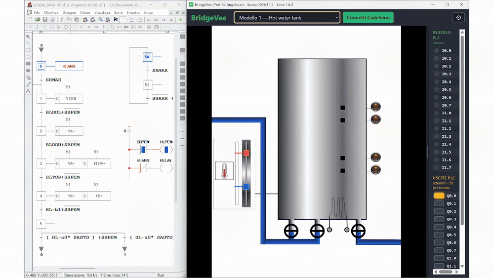

  

# BridgeVee

E' un software gratuito per Windows che rende disponibili una serie di scene interattive relative a impianti di automazione di vario genere e difficoltà. Queste scene possono essere comandate e fatte funzionare in 2 modi: direttamente tramite simulatore **CADe_SIMU** (con il programma scritto in logica cablata, ladder o grafcet), oppure tramite un PLC reale collegato al computer tramite dispositivo di interfaccia **[Festo EasyPort](https://www.festo.com/ch/it/p/easyport-usb-id_PROD_DID_548687?page=0)** (USB). BridgeVee è in grado anche di caricare ed eseguire le scene del software **Festo EasyVeep** se questo risulta installato ne PC.
Serve a provare, in classe o a casa, i programmi PLC su impianti virtuali: gli ingressi (sensori) e le uscite (attuatori) si vedono a destra, la scena si muove di conseguenza.

## Installazione

1. Vai alla pagina delle [**Releases**](https://github.com/gio-dot/BridgeVee/releases), cerca la versione di `core-vx.x.x` più alta e in **Assets** scarica `BridgeVee-Setup-x.x.x.exe`. <u>Non è necessario scaricare il pacchetto scene in quanto incluso con il core.</u>

2. Esegui il file scaricato e scegli se installare **solo per te** (password amministratore non necessaria) o **per tutti gli utenti** (password amministratore richiesta).

3. Gli **aggiornamenti** successivi riguardanti il software o i pacchetti di scene, saranno proposti automaticamente all'apertura del programma; dall'avviso sarà possibile installarli con un clic.

**NOTE:**

Se sul proprio PC è installato **Festo EasyVeep (facoltativo)**, le scene di questo saranno importate automaticamente in BridgeVee; se non vengono trovate apri le Impostazioni (l'ingranaggio in alto a destra) e scegli la cartella `flash` (di solito `C:\Program Files (x86)\didactic\EasyVeep 2\flash`).

**Avviso di Windows.** Il programma non ha una firma digitale a pagamento, quindi Windows (SmartScreen) può mostrare "Windows ha protetto il PC". Premi **Ulteriori informazioni** e poi **Esegui comunque**.

## Requisiti

- Windows 10 o 11 (64 bit).
- Per i modelli Festo: l'installazione di **EasyVeep 2** sullo stesso computer. BridgeVee non contiene i modelli Festo, legge quelli già presenti nella cartella `flash` di EasyVeep. Le scene "(nuovo)" sono incluse e non richiedono EasyVeep.
- Per collegare un PLC reale: scheda **EasyPort** con cavo USB, oppure **CADe_SIMU**.

## Come si usa

1. Scegli la scena dall'elenco in alto.
2. A destra vedi gli **ingressi** (sensori, verso il PLC) e le **uscite** (attuatori, dal PLC).
3. Senza PLC collegato la scena esegue da sola una dimostrazione (**AUTO**); con **MANUALE** puoi attivare le uscite a mano.
4. Con un PLC: apri le Impostazioni, scegli la sorgente (EasyPort o CADe_SIMU) e premi il pulsante verde **Connetti**.

Il manuale completo sarà disponibile qui: _(link in arrivo)_.

## Scene aggiunte a mano

Altri file `.swf` si possono copiare nella cartella `%APPDATA%\BridgeVee\MyScenes` (Impostazioni → *Scene aggiunte a mano* → *Apri cartella*). Compaiono nell'elenco dopo "Aggiorna elenco".

## Numeri di versione

Il titolo della finestra mostra due numeri: **Release** (per esempio `2026.11.1`, cresce a ogni aggiornamento di scene o programma) e **Core** (il numero del programma di base).

## Licenza

© 2026 Prof. G. Angelucci. Tutti i diritti riservati. L'uso è **gratuito**: vedi il file [LICENSE](LICENSE).
I componenti di terzi inclusi nel programma hanno le loro licenze: vedi [THIRD_PARTY.md](THIRD_PARTY.md).

BridgeVee non è affiliato a Festo né ai produttori di EasyPort e CADe_SIMU. I nomi citati appartengono ai rispettivi proprietari.

## Contatti e segnalazioni

_(indirizzo e-mail o modulo di contatto)_
