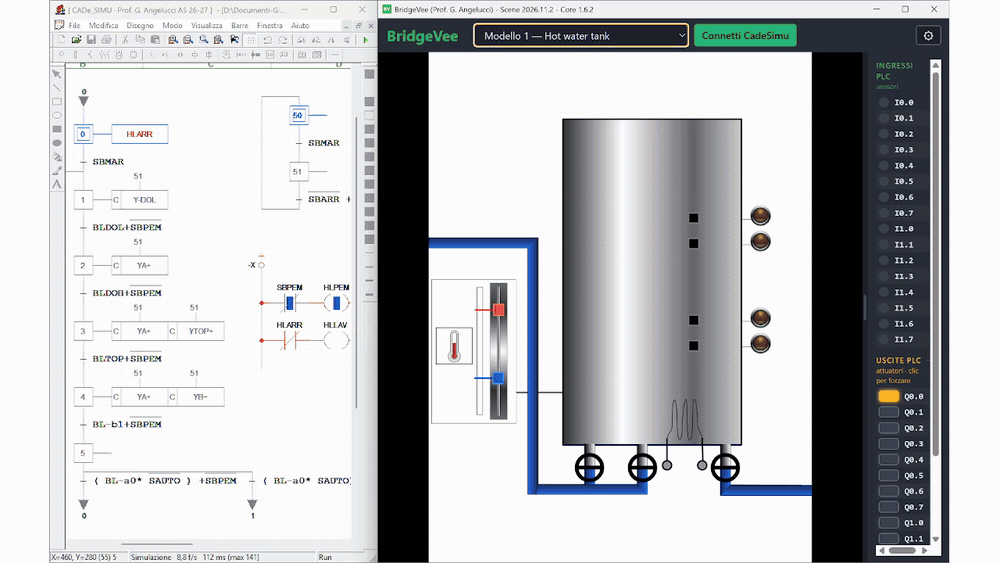

# BridgeVee

E' un software gratuito per Windows che rende disponibili una serie di scene interattive relative a impianti di automazione di vario genere e difficoltà. Queste scene possono essere comandate e fatte funzionare in 2 modi: direttamente tramite simulatore **CADe_SIMU** (con il programma scritto in logica cablata, ladder o grafcet), oppure tramite un PLC reale collegato al computer tramite dispositivo di interfaccia **[Festo EasyPort](https://www.festo.com/ch/it/p/easyport-usb-id_PROD_DID_548687?page=0)** (USB). BridgeVee è in grado anche di caricare ed eseguire le scene del software **Festo EasyVeep** se questo risulta installato ne PC.
Serve a provare, in classe o a casa, i programmi PLC su impianti virtuali: gli ingressi (sensori) e le uscite (attuatori) si vedono a destra, la scena si muove di conseguenza.

**NUOVE SCENE SARANNO AGGIUNTE REGOLARMENTE; SE VUOI RICHIEDERE UNA SCENA PERSONALIZZATA SCRIVI [QUI](https://github.com/gio-dot/BridgeVee/issues).

[Scarica l'ultima versione](https://github.com/gio-dot/BridgeVee/releases){: .btn .btn-primary }
[Guida]({{ site.baseurl }}/guida/){: .btn }